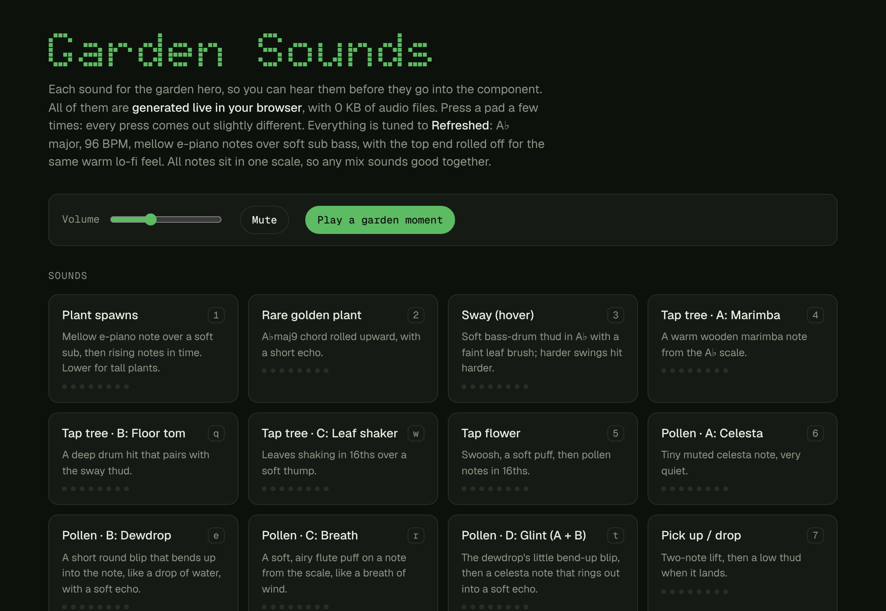
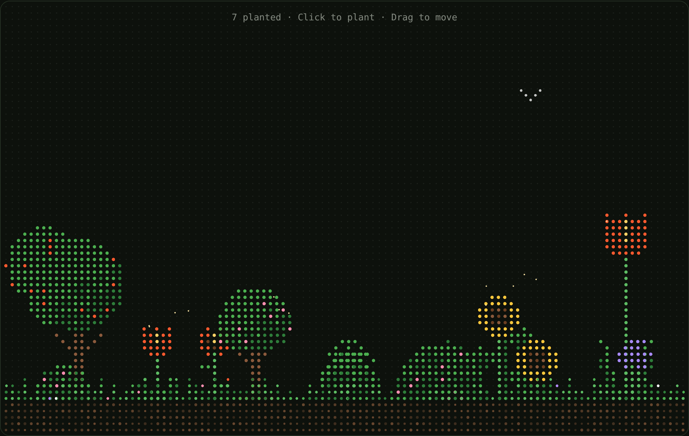

# soundhub

**A garden that makes music.** Every sound here is synthesized live in the browser with the Web Audio API. There are no audio files and nothing to download, and every sound is tuned to one key, so whatever you play together sounds good.

**[▶ Open the Garden Sound Board](https://r-vansh.github.io/soundhub/)**



---

## What's inside

| | |
|---|---|
| **[Garden Sound Board](https://r-vansh.github.io/soundhub/)** ([`docs/index.html`](docs/index.html)) | A playable board with every sound from the garden: 15 pads, 4 ambient beds, a swipe test strip and the live garden with all the sounds wired in. |
| **[Garden Hero component](garden-sound-pad/)** ([`GardenHero.tsx`](garden-sound-pad/GardenHero.tsx)) | The Framer code component the sounds were made for: a dot-grid garden you plant, sway, drag and prune, with birds and pollen. |



## The sound

Everything is tuned to the track **Refreshed**:

- **Key:** A♭ major pentatonic (A♭ B♭ C E♭ F), so no two notes ever clash.
- **Tempo:** 96 BPM. Follow-up notes land on 16th notes, so quick sequences stay in time.
- **Tone:** mellow e-piano notes over a soft sub bass, sent through a lo-fi chain (a low-pass "tape" filter at 3.6 kHz, gentle saturation and a compressor) for a warm, rounded feel.
- **Variation:** each press is slightly different. Pitch, timing and noise are randomized within the scale, so repeats never sound robotic.
- **Polyphony:** capped at 24 voices, and swipe sounds are rate-limited, so fast gestures never pile into noise.

## Sound pads

| Key | Sound | What you hear |
|:---:|---|---|
| `1` | Plant spawns | An e-piano note over a soft sub, then rising notes in time. Tall plants start lower. |
| `2` | Rare golden plant | An A♭maj9 chord rolled upward, with a short echo. About 1 in 25 plants. |
| `3` | Sway (hover) | A soft bass-drum thud in A♭ with a faint leaf brush. Harder swings hit harder. |
| `4` | Tap tree · A: Marimba | A warm wooden marimba note from the scale. |
| `Q` | Tap tree · B: Floor tom | A deep drum hit that pairs with the sway thud. |
| `W` | Tap tree · C: Leaf shaker | Leaves shaking in 16ths over a soft thump. |
| `5` | Tap flower | A swoosh, a soft puff, then pollen notes in 16ths. |
| `6` | Pollen · A: Celesta | A tiny muted celesta note. |
| `E` | Pollen · B: Dewdrop | A round blip that bends up into the note, with a soft echo. |
| `R` | Pollen · C: Breath | An airy flute puff on a note from the scale. |
| `T` | Pollen · D: Glint | The dewdrop blip into a celesta note that rings out. |
| `7` | Pick up / drop | A two-note lift, then a low thud when it lands. |
| `8` | Remove at edge | Four notes falling down the scale as the plant fades. |
| `9` | Flock arrives | One or two soft, distant chirps from the side. |
| `0` | Flock scatters | A wing flutter and a burst of chirps. |

**Play a garden moment** strings a dozen of these together into a short scripted scene.

## Ambient beds

Four slow, continuous pads on bright major chords (A♭maj9, D♭maj9♯11, E♭add9, D♭/E♭), changing every 4 bars. They fade in over a couple of seconds, and only one plays at a time.

1. **Sunny pad:** detuned saw chords through a filter that slowly breathes open and closed.
2. **Breathing pulse:** the same pad, gently ducking on every beat like a lo-fi sidechain.
3. **Pad with slow arp:** a quieter pad with soft notes rolling up and down each chord in 8ths.
4. **Lo-fi tape:** the pad with a slow pitch wobble and a bass line walking through each chord.

## Using the board

- **Click or tap a pad**, or press its key, to play it. The first click or tap anywhere turns sound on, as browsers require.
- **Swipe test:** move your cursor or finger across the dotted strip. Slow drags tick softly and fast flicks roll loud and dense. On a phone, a readout shows how many thuds played and your device's audio delay, and two sliders tune the touch response.
- **Live garden:** click to plant, hover or swipe to sway, tap a plant to hear it, drag to move it, and drop it at an edge to remove it. The Tree tap and Pollen menus pick which variant the garden uses. **Reset garden** clears it.
- **Volume** and **Ambient level** set the mix, and **Mute** silences everything.

## Using the component in Framer

1. In Framer, go to **Assets → Code → New Code File**.
2. Paste in [`garden-sound-pad/GardenHero.tsx`](garden-sound-pad/GardenHero.tsx).
3. Drag **GardenHero** onto the canvas and size it, for example as a full-width hero.

Every option is a property control in the right-hand panel:

| Group | Controls |
|---|---|
| Planting | Plant On (Ground / Anywhere), Min Height, Max Height, Max Plants, Remember (keeps the garden between visits) |
| Ground | Ground, Ground Height, Soil |
| Colours | Grid, Petals, Centre, Stem, Leaf, Leaf Shade, Trunk, Rare, Background |
| Dots | Grid Gap, Grid Dot, Plant Dot, Wind |
| Life | Pollen, Pollen Color, Birds, Bird Color, Flocks / min |
| Text | Counter, Font, Text |
| Sound | Sound, Volume, Start Muted, Mute Icon, Tree Tap, Pollen Sound, Ambient, Ambient Volume |

The editor canvas stays silent on purpose. Test sound in **Preview** or on the published site. The component's own [README](garden-sound-pad/README.md) has a full sound test checklist.

## Run it locally

The board is a single static HTML file, so no build step is needed:

```sh
git clone https://github.com/r-vansh/soundhub.git
cd soundhub/docs
python3 -m http.server 8000
```

Then open <http://localhost:8000>. Serve it over HTTP rather than opening the file directly, so the browser loads the bundled React from `docs/vendor/`.

## Project layout

```
soundhub/
├── docs/                    # GitHub Pages site
│   ├── index.html           # the Garden Sound Board (sound engine, pads and live garden)
│   └── vendor/              # React 18.3.1, served locally so there is no CDN dependency
├── garden-sound-pad/
│   ├── GardenHero.tsx       # the Framer code component
│   └── README.md            # Framer setup and sound test checklist
└── .github/assets/          # screenshots for this README
```

## Publishing

GitHub Pages serves the `docs/` folder from the `main` branch. To set it up, go to **Settings → Pages → Build and deployment**, choose **Deploy from a branch**, then pick `main` and `/docs`. Any push to `main` that changes `docs/` redeploys the site within a minute or so.

## Browser support

The board works in any current browser with Web Audio: Chrome, Edge, Firefox and Safari, on desktop and mobile. On iPhone, sound follows the ring/silent switch, so turn silent mode off to hear it.

---

Made by [Vansh Rastogi](https://github.com/r-vansh).
